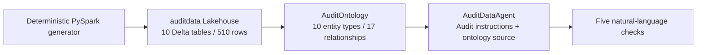

# AuditWS: financial customer audit demo in Microsoft Fabric

A reproducible, **synthetic-data-only** demo combining a Fabric Lakehouse, a Retail-style ontology, and an ontology-grounded Fabric Data Agent.

The original demo was built and verified on **October 23, 2026**. All five real Data Agent test responses matched independent Spark SQL results. The scripts in this repository are portable versions of that work; local package validation is not a claim that they have been deployed into your tenant.

> **Preview / version notice:** This package intentionally uses the **old JSON ontology experience**, matching the RetailOnto example used for the demo. Fabric displayed a retirement date of **January 31, 2027** for that experience. Creating old-experience items may require the REST API rather than the current ontology UI. Do not substitute the newer TMDL ontology definition format into these scripts. Check current support before investing in this as a long-lived solution.

## What you will create



The agent is a **Fabric Data Agent**, not a Microsoft Foundry agent. You do not need to provision a Foundry project, model deployment, Azure AI Search index, or external application.

### Repository contents

| Path | Purpose |
|---|---|
| [data/create_audit_data.py](data/create_audit_data.py) | Creates and exactly validates all 10 Delta tables inside Fabric Spark. |
| [data/expected-validation.json](data/expected-validation.json) | Table schemas, row counts, 17 key relationships and independently computed answers. |
| [ontology/AuditOntology.template.json](ontology/AuditOntology.template.json) | Portable 55-part ontology request, generated with illustrative IDs. |
| [agent/instructions.txt](agent/instructions.txt) | Complete audit instructions; no preloaded example answers. |
| [agent/AuditDataAgent.template.json](agent/AuditDataAgent.template.json) | Draft agent request using the ontology source format exported from the working UI. |
| [scripts/New-AuditOntology.ps1](scripts/New-AuditOntology.ps1) | Builds/imports and verifies an ontology with your actual workspace/Lakehouse IDs. |
| [scripts/New-AuditDataAgent.ps1](scripts/New-AuditDataAgent.ps1) | Optional REST route to create and verify a draft Data Agent. |
| [scripts/FabricApi.psm1](scripts/FabricApi.psm1) | In-memory Azure CLI authentication and Fabric long-running-operation handling. |
| [scripts/Test-DemoPackage.ps1](scripts/Test-DemoPackage.ps1) | Offline syntax, payload, rebinding, serialization and baseline checks; no cloud calls. |
| [examples/verified-agent-results.json](examples/verified-agent-results.json) | Structured answers from the five original live agent tests. |
| [examples/validation-queries.sql](examples/validation-queries.sql) | Independent Spark SQL checks. |
| [docs/data-model.md](docs/data-model.md) | Entity model, data semantics and relationships. |
| [docs/troubleshooting.md](docs/troubleshooting.md) | Actual issues encountered and their remedies. |

No credentials, bearer tokens, private customer data, raw browser logs, Retail workspace exports, original cloud resource IDs, or failed-import backing resources are included. The generator is the complete source of the 510 rows; you do not need a separate data download.

## Prerequisites

1. A Microsoft Fabric tenant with an **active capacity** supporting Lakehouse/Spark, ontology preview and Fabric Data Agent. A paused capacity does not work.
2. Permission to create items in the target workspace (Contributor or higher), and access to the Lakehouse data used by the agent.
3. Fabric tenant settings enabling ontology preview, Data Agent, and the required Copilot/Azure OpenAI features for your user/security group. Applicable cross-region processing settings and regional availability must also permit the workload.
4. A **schema-enabled Lakehouse**: this demo writes to `dbo.<table>`.
5. For REST scripts: **PowerShell 7+**, **Azure CLI**, and tenant permissions for the relevant Fabric item APIs. There is no local Python, Spark, Foundry SDK, or third-party PowerShell module requirement.
6. Use a dedicated demo workspace. Spark and other Fabric workloads can consume capacity; this is not a zero-cost guarantee.

See Microsoft's [Data Agent tenant settings](https://learn.microsoft.com/fabric/data-science/data-agent-tenant-settings) and [ontology-grounded Data Agent guide](https://learn.microsoft.com/fabric/iq/ontology/how-to-create-data-agent).

## Step-by-step recreation

### 1. Get the repository and authenticate

Clone this repository and open PowerShell 7 in its root:

```powershell
git clone https://github.com/chbasani/AuditWS.git
Set-Location .\AuditWS
```

Authenticate Azure CLI to the tenant containing your Fabric workspace:

```powershell
$tenantId = '<YOUR-ENTRA-TENANT-ID>'
az login --tenant $tenantId --allow-no-subscriptions
```

Follow the browser authentication prompt. This is separate from signing into the Fabric portal. The scripts request a token for `https://api.fabric.microsoft.com` and hold it in memory; never paste it into a file or commit it.

Optional offline check (does not require authentication):

```powershell
.\scripts\Test-DemoPackage.ps1
```

### 2. Create the workspace and Lakehouse

1. In Fabric, create a workspace named **AuditWS**, or choose a dedicated existing demo workspace.
2. Assign it to a supported **running** capacity.
3. Choose **New item > Lakehouse**, enter **auditdata**, and enable Lakehouse schemas if that choice is shown.
4. Open the Lakehouse. Record the workspace and Lakehouse IDs from its URL:
   `.../groups/<workspace-id>/lakehouses/<lakehouse-id>`.
5. Set your own IDs in PowerShell:

```powershell
$workspaceId = '<YOUR-WORKSPACE-ID>'
$lakehouseId = '<YOUR-AUDITDATA-LAKEHOUSE-ID>'
```

Do not use the illustrative IDs in the checked-in templates to deploy.

### 3. Populate and validate the 10 tables

1. Create a **Fabric notebook** in AuditWS, using **PySpark**.
2. Attach **auditdata** as its **default Lakehouse**.
3. Copy the complete contents of [data/create_audit_data.py](data/create_audit_data.py) into a Python cell and run it.
4. Wait for the Spark session and all validation actions to complete. A successful run ends with an `AUDIT_VALIDATION_JSON=...` line.
5. Refresh the Lakehouse explorer. Confirm the following `dbo` tables:

| Table | Rows | Entity |
|---|---:|---|
| customers | 12 | Customer |
| accounts | 24 | Account |
| transactions | 240 | FinancialTransaction |
| invoices | 60 | Invoice |
| payments | 48 | Payment |
| audit_engagements | 12 | AuditEngagement |
| controls | 6 | AuditControl |
| control_tests | 72 | ControlTest |
| findings | 12 | AuditFinding |
| evidence_documents | 24 | EvidenceDocument |
| **Total** | **510** | **10 types** |

The table counts sum to **510**. An earlier conversational summary incorrectly stated 610; this repository corrects that arithmetic without changing any data.

The script checks exact persisted contents, schema types, row counts, primary-key uniqueness and all 17 foreign keys. It creates missing tables with `errorifexists`; existing tables are validated, **not overwritten**. If validation fails, inspect the mismatch instead of deleting someone else's tables.

The data is deliberately fixed to audit period **2026-01-01 through 2026-09-30**, with audit as-of date **2026-10-22** and currency **USD**. Do not replace the as-of date with today's date when comparing the recorded examples.

You may independently run [examples/validation-queries.sql](examples/validation-queries.sql) in Spark SQL cells. These are data checks, **not agent test runs**.

### 4. Create AuditOntology

Use the REST builder to preserve the original Retail-style JSON definition:

```powershell
.\scripts\New-AuditOntology.ps1 `
    -TenantId $tenantId `
    -WorkspaceId $workspaceId `
    -LakehouseId $lakehouseId `
    -Verbose
```

The script:

1. Builds 10 entity definitions, 10 Lakehouse bindings, 17 relationship definitions and 17 contextualizations, plus a root definition: **55 parts**.
2. Points every source at your workspace, your `auditdata` Lakehouse, and schema `dbo`.
3. Preserves discriminator ordering required by Fabric (`dataBindingType` and `sourceType` first).
4. Rejects an existing `AuditOntology` rather than silently replacing it.
5. Waits for the **actual asynchronous import result**. HTTP 202 alone is not success.
6. Fetches the persisted definition and checks all four expected part counts.
7. Saves requests, item metadata and retrieved definitions under ignored `artifacts/`.

Record the returned ontology ID:

```powershell
$ontologyId = (Get-Content .\artifacts\ontology-item.json -Raw | ConvertFrom-Json).id
```

Open AuditOntology in the workspace. Verify the 10 entity types and their bindings/relationships. Allow time for initialization and source availability.

To build a request without authenticating or creating anything:

```powershell
.\scripts\New-AuditOntology.ps1 `
    -WorkspaceId $workspaceId -LakehouseId $lakehouseId -BuildOnly
```

The checked-in [ontology template](ontology/AuditOntology.template.json) is a reference build, not an export pointing at the original tenant. Prefer the script to rebind all nested source IDs correctly.

### 5. Create and configure AuditDataAgent

**Recommended: reproduce the verified UI flow.**

1. In AuditWS select **New item > Data agent** and name it **AuditDataAgent**.
2. In the agent, choose **Add an ontology** (or **Add sources > Ontology**, depending on the UI version).
3. Select **AuditOntology** from the OneLake catalog and choose **Add**.
4. Confirm all **10 entity types** are selected. Let source initialization finish.
5. Open **Agent instructions** from the toolbar; it may be under **More items** on smaller screens.
6. Paste all of [agent/instructions.txt](agent/instructions.txt). Confirm it saves.
7. Keep the standard runtime for comparison with the original run. Runtime/model versions are service-managed and can change.

The saved configuration uses `draft/ontologies/AuditOntology/ontology.json`. The source is the ontology, not a manually substituted direct-Lakehouse-only source. Fabric may route queries to the ontology's bound Lakehouse tables; that is expected. The original live responses referenced AuditOntology and analyzed `auditdata` through those bindings.

**Optional: create the draft through REST instead.**

```powershell
.\scripts\New-AuditDataAgent.ps1 `
    -TenantId $tenantId `
    -WorkspaceId $workspaceId `
    -OntologyId $ontologyId
```

This builder uses the source shape exported from the working UI, saves the request and definition under `artifacts/`, and verifies instructions, ontology ID and 10 selected entities after creation. It does **not** publish or run agent questions. The packaged REST-create route is offline-tested; the original live agent was configured with the UI workflow above.

If the agent already exists, do not run the creation script over it. Open that item and inspect it. The complete generated reference request is in [agent/AuditDataAgent.template.json](agent/AuditDataAgent.template.json).

### 6. Run five real agent examples

In **Test data agent**, submit the five prompts below one at a time. The original run used one sequential chat. Record actual responses; do not paste expected answers into agent instructions or represent a Spark SQL check as an agent response.

| # | Prompt | Expected result |
|---|---|---|
| 1 | Using AuditOntology, list all customers with RiskRating = 'High', including CustomerId and CustomerName. Query the data rather than guessing. | C004 / Synthetic Customer 4; C008 / Synthetic Customer 8; C012 / Synthetic Customer 12. Order need not match. |
| 2 | Using AuditOntology, for findings with Status = 'Open', group by Severity and return the finding count and sum of ExposureAmount in USD. Do not include closed findings. | High: 2, USD 18,000.00. Low: 6, USD 54,000.00. |
| 3 | Using AuditOntology, as of 2026-10-22, how many invoices are overdue and unpaid, and what is their total outstanding balance in USD? Calculate outstanding as InvoiceAmount minus the sum of payments for each invoice; filter DueDate before 2026-10-22 and positive outstanding. Avoid double counting. | 12 invoices; USD 60,750.00 outstanding. |
| 4 | Using AuditOntology, group control tests with Result = 'Fail' by ControlId. Return the failure count and total ExceptionCount for each control. | CTL06: 12 failed tests, 36 exceptions. |
| 5 | Using AuditOntology, list open findings whose RemediationDueDate is before 2026-10-22. Include FindingId, CustomerId, Severity and ExposureAmount in USD, ordered by FindingId. | F002 / C002 / Low / 3,000.00; F004 / C004 / High / 6,000.00; F008 / C008 / High / 12,000.00; F010 / C010 / Low / 15,000.00. |

All five passed in the original live run. The UI reported response times of **15, 9, 17, 7 and 12 seconds** respectively; these are observations, not an SLA.

See [recorded results](examples/verified-agent-results.json) for exact prompt text and structured returned values. Generative wording can vary; verify identifiers, filters, counts and amounts rather than prose.

### 7. Publish in Fabric

1. After the tests pass, select **Publish** in the toolbar / **More items** menu.
2. Enter a description of purpose and capabilities, for example:

   > Answers financial customer audit questions using AuditOntology bound to the 10 synthetic auditdata tables. Covers customer risk, invoices and payments, control tests, findings, remediation and evidence metadata. Amounts are USD; default as-of date is 2026-10-22. Synthetic demonstration data only.

3. Leave **Also publish to Microsoft 365 Copilot** **Off**, matching the original demo.
4. Select **Publish** and wait for completion.
5. Confirm a published version is available. Review the published source and instructions, not just the draft.

Publishing is not a permission bypass: users still need appropriate access to the workspace/source data. Sharing or Microsoft 365 rollout is outside this demo.

### 8. Finish and clean up safely

- Stop the notebook's Spark session when finished to release compute.
- Retain the Lakehouse, ontology and published agent if you want to reuse the demo.
- Failed ontology imports can leave generated backing Lakehouses, SQL endpoints and graph items. Inspect ownership and references before deleting any item.
- Do not delete a workspace, shared tables, or an ontology's live backing resources to fix a failed test.
- Keep `artifacts/` local; it contains your generated tenant-specific requests and item IDs and is ignored by Git.

## Security, limitations and reproducibility

- Every data row is marked `IsSynthetic=true`; names and IDs are artificial. Evidence rows contain **metadata only**, not real documents.
- Exposure is a risk estimate, **not** a confirmed loss. Do not sum it with balances, transaction amounts or receivables as a single financial measure.
- This is not an audit opinion or production financial-control system.
- The relationship declarations are validated by the generator; they are not a claim that Delta enforces relational foreign-key constraints.
- No credentials belong in configuration, code, notebook outputs committed to Git, or screenshots. Use your own authentication context.
- The original Retail ontology was used as a structural reference; no Retail data or exported reference assets are redistributed here.
- The REST helpers target the public commercial-cloud Fabric API. Sovereign-cloud endpoint configuration is not implemented.
- New tenants may use newer ontology/Data Agent schemas. See [troubleshooting](docs/troubleshooting.md) and current Microsoft documentation before changing formats.

## Microsoft documentation

- [Fabric Lakehouse overview](https://learn.microsoft.com/fabric/data-engineering/lakehouse-overview)
- [Ontology old JSON item definition](https://learn.microsoft.com/rest/api/fabric/articles/item-management/definitions/ontology-old-definition)
- [Create ontology REST API](https://learn.microsoft.com/rest/api/fabric/ontology/items/create-ontology)
- [Create a Data Agent grounded in an ontology](https://learn.microsoft.com/fabric/iq/ontology/how-to-create-data-agent)
- [Fabric Data Agent item definition](https://learn.microsoft.com/rest/api/fabric/articles/item-management/definitions/data-agent-definition)
- [Create Data Agent REST API](https://learn.microsoft.com/rest/api/fabric/dataagent/items/create-data-agent)
- [Fabric long-running operations](https://learn.microsoft.com/rest/api/fabric/articles/long-running-operation)
