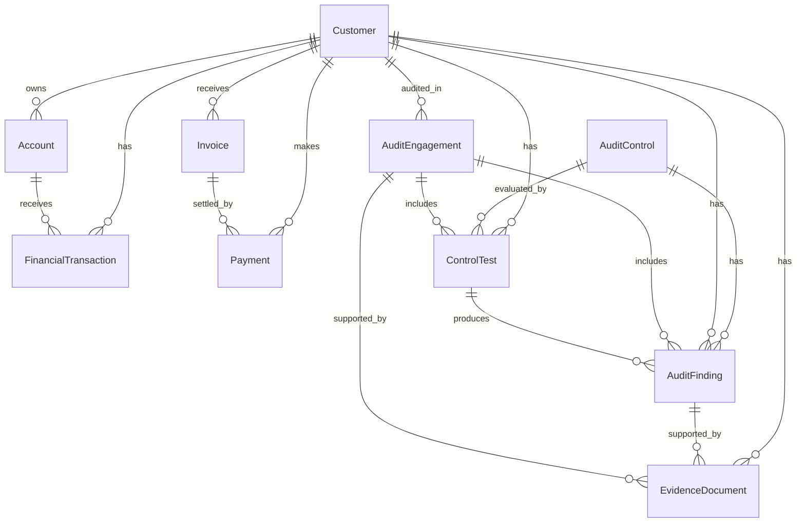

# Data model and audit semantics

All tables live under `auditdata.dbo`. IDs are strings. Monetary columns use `decimal(18,2)` in Delta and are exposed as `Double` in the old ontology format; do not rely on binary floating-point for production monetary accounting. Dates map to ontology `DateTime`, integers to `BigInt`, and `IsSynthetic` to `Boolean`.

The complete column/type inventory and relationship tuples are in [expected-validation.json](../data/expected-validation.json).

## Entities and keys

| Table | Entity type | Primary key | Grain |
|---|---|---|---|
| customers | Customer | CustomerId | One synthetic customer |
| accounts | Account | AccountId | One customer account |
| transactions | FinancialTransaction | TransactionId | One account posting |
| invoices | Invoice | InvoiceId | One customer invoice |
| payments | Payment | PaymentId | One payment against an invoice |
| audit_engagements | AuditEngagement | EngagementId | One customer audit engagement |
| controls | AuditControl | ControlId | One control definition |
| control_tests | ControlTest | TestId | One control test in an engagement |
| findings | AuditFinding | FindingId | One finding from a failed test |
| evidence_documents | EvidenceDocument | EvidenceId | One evidence metadata record |

## All 17 relationships

Relationships point from the child entity to its parent. Each contextualization binds the child primary key to the source entity and the child foreign key to the target entity's primary key.

| Relationship | Child foreign key | Parent key |
|---|---|---|
| AccountBelongsToCustomer | accounts.CustomerId | customers.CustomerId |
| TransactionPostedToAccount | transactions.AccountId | accounts.AccountId |
| TransactionForCustomer | transactions.CustomerId | customers.CustomerId |
| InvoiceForCustomer | invoices.CustomerId | customers.CustomerId |
| PaymentSettlesInvoice | payments.InvoiceId | invoices.InvoiceId |
| PaymentFromCustomer | payments.CustomerId | customers.CustomerId |
| EngagementAuditsCustomer | audit_engagements.CustomerId | customers.CustomerId |
| TestInEngagement | control_tests.EngagementId | audit_engagements.EngagementId |
| TestEvaluatesControl | control_tests.ControlId | controls.ControlId |
| TestForCustomer | control_tests.CustomerId | customers.CustomerId |
| FindingFromTest | findings.TestId | control_tests.TestId |
| FindingInEngagement | findings.EngagementId | audit_engagements.EngagementId |
| FindingForCustomer | findings.CustomerId | customers.CustomerId |
| FindingForControl | findings.ControlId | controls.ControlId |
| EvidenceForEngagement | evidence_documents.EngagementId | audit_engagements.EngagementId |
| EvidenceSupportsFinding | evidence_documents.FindingId | findings.FindingId |
| EvidenceForCustomer | evidence_documents.CustomerId | customers.CustomerId |

## Deterministic scenarios

- 12 customers, with C004, C008 and C012 rated High.
- Two accounts per customer and 240 transactions, including manual postings and large pending-approval examples.
- 60 invoices; every fifth invoice is unpaid, leaving 12 unpaid invoices and 48 matching payments.
- Six controls tested once for each customer: 72 tests.
- CTL06 (Evidence retention) fails once per customer with three exceptions per test.
- One finding per failed test; every third finding is Closed.
- Two evidence metadata records per customer; selected records await review.

## Aggregation rules

- **Outstanding invoice** = invoice amount minus payments aggregated per invoice; missing payments mean zero paid.
- **Overdue invoice** = positive outstanding and DueDate strictly earlier than the as-of date.
- **Open exposure** = ExposureAmount only where Status is Open. Exposure is not a confirmed loss.
- **Overdue remediation** = Status Open and RemediationDueDate strictly earlier than the as-of date.
- **Failed tests** count test rows; **exceptions** sum ExceptionCount. They are different measures.
- Aggregate at the natural grain before joining multiple one-to-many collections to avoid inflated amounts.
- RiskRating (customer) and Severity (finding) are separate dimensions.

The original independent overdue-invoice check used the deterministic Unpaid status. The packaged SQL computes payment-adjusted outstanding instead, matching the agent instructions and yielding the same USD 60,750.00 baseline for these exact rows.
